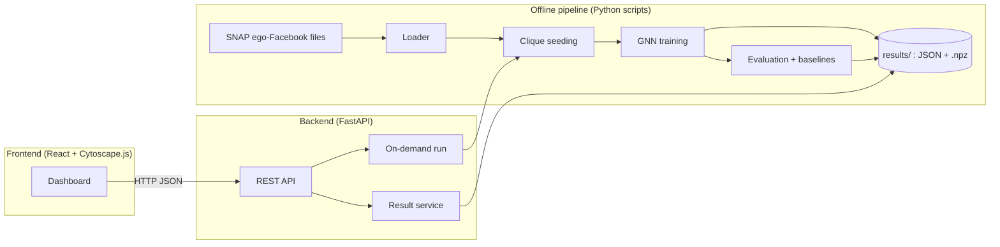

# CircleSense: Overlapping Friend-Circle Detection with Clique Percolation and Graph Neural Networks

BDSMA micro-project, Semester 7. Based on *Paper 4: Overlapping Community Detection: Combining Clique Percolation with Graph Neural Networks* (Module 4: Social Network Structure, Measures and Visualization).

> **Status:** this README is the project design. No code has been written yet. Everything below describes what we plan to build.

---

## 1. The problem

On a social network, one person belongs to several groups at once. A friend can be a college classmate and also a colleague, so they sit in two friend circles. Popular community detection algorithms such as Louvain and Leiden put every node in exactly one community, so they cannot represent this.

Two families of methods do handle overlap, and each has a weakness:

| Method family | Strength | Weakness |
|---|---|---|
| Clique Percolation (CPM) | Communities are easy to explain: each one is a chain of tightly knit cliques | Clique enumeration is slow on dense graphs, and nodes outside any clique get no community |
| Graph Neural Networks (NOCD-style) | Scale well, use node attributes, assign every node | The result is a black box: you cannot say why a node is in a community |

**Our project combines them.** Cliques give interpretable seed communities. A GNN then generalises those seeds to the whole graph and outputs soft memberships, so a node can belong to several circles.

## 2. The real-world application

**Automatic friend circles and friend suggestions for a Facebook user.**

Given one user's friend network, the system:

1. Detects the user's circles (family, school, college, work, and so on) without manual labelling.
2. Identifies "bridge friends" who belong to several circles.
3. Suggests new friends to any member of the network, drawn from the circles they share with others.
4. Explains each circle by showing the clique seed it grew from.

A platform would use this for audience lists ("share with college friends"), friend suggestions and group suggestions.

## 3. Dataset

**Primary: SNAP `ego-Facebook`** (https://snap.stanford.edu/data/ego-Facebook.html)

- 10 ego-networks, about 4,039 nodes and 88,234 edges combined.
- Ego IDs: 0, 107, 348, 414, 686, 698, 1684, 1912, 3437, 3980.
- Per ego, five files:

| File | Content |
|---|---|
| `<id>.edges` | Friendships among the ego's friends |
| `<id>.circles` | Hand-labelled circles, overlapping (the ground truth) |
| `<id>.feat` | Anonymised binary profile features per friend |
| `<id>.egofeat` | The ego's own features |
| `<id>.featnames` | Feature names (anonymised) |

Why this dataset:
- Papers #11 and #26 both evaluate on it, so our numbers can be compared with published ones.
- Paper #11 describes its circles as hand-labelled and reliable.
- Each network is small (66 to about 1,000 nodes), so everything runs on a laptop CPU.

**Optional scale test:** SNAP `com-DBLP` (top-5000 communities subgraph) or a synthetic graph, used only for the runtime-versus-size plot.

## 4. What we take from which paper

"Access" records how much of each paper we actually read, so nobody over-claims in the report.

| # | Paper | Access | What we use |
|---|---|---|---|
| Outline | Paper 4 (assigned) | Full | Overall pipeline: k-clique seeds (k = 3 to 5), GraphSAGE/GAT encoder, soft-membership head, seed-consistency loss, baselines, metrics, figure list |
| 26 | WOCD: semi-supervised OCD using weak cliques (2025) | Full text | Weak-clique extraction as a cheaper seeding option; the idea of turning clique membership into per-node pseudo-labels |
| 11 | Dynamic dilated aggregation in deep residual GCN (2022) | Full text | Encoder-decoder framing with a Bernoulli-Poisson decoder; Facebook ego-networks as benchmark; threshold search for membership |
| 3 | WLNI-LPA (2021) | Full text | Using detected overlapping communities inside a social recommender; precision, recall and F1 for recommendation quality |
| 16 | Weighted graph community games (2023) | Full text | Treating bridge-node detection as its own task with precision, recall and F1; Omega index |
| 20 | Hierarchical clustering on maximal cliques (2024) | Full text | Metric set: ONMI, F1, Omega index, overlapping-nodes F1; rule that unassigned nodes take the most common community among neighbours |
| 30 | ABCD+o² benchmark (2026) | Full text | Synthetic graphs with controllable overlap for the sensitivity and scalability plots |
| 18 | Comparative analysis on social media platforms (2023) | Abstract | Justification for the baseline set (LPA, CPM, DEMON, NMF) and for modularity plus NMI as metrics |
| 27 | Noise-resilient semi-supervised graph autoencoder (2025) | Abstract | Optional robustness test: corrupt a share of node features and re-measure |
| 25 | T-OCDIB, temporal overlapping communities (2025) | Abstract | Future work only: temporal smoothing across snapshots |
| 8 | Review of clique-based OCD algorithms (2022) | Title only | Cited as background for CPM; not used for design decisions |

The remaining references are cited in the related-work section only.

## 5. Method

### 5.1 Pipeline

```
ego-network ──► clique seeding ──► seed matrix S ──► GNN encoder ──► membership matrix F ──► threshold ──► circles
   (A, X)        (CPM or weak        (N × K)        (A, [X | S])        (N × K, ≥ 0)                      + bridge friends
                  cliques)                                                                                + suggestions
```

### 5.2 Step by step

1. **Load.** Build the adjacency matrix `A` and feature matrix `X` for one ego-network.
2. **Seed.** Two interchangeable strategies:
   - *CPM seeds:* find all k-cliques, and merge cliques that share k−1 nodes into one seed community.
   - *Weak-clique seeds (paper #26):* for a linked pair `u, v`, the weak clique is `{u, v}` plus their common neighbours. Start nodes are picked by a density-based priority and paired with their most similar neighbour (Salton index).
3. **Merge and cap.** Merge seeds whose Jaccard overlap exceeds a limit, then keep the `K` largest. This fixes the number of output communities and ties output column `c` to seed `c`.
4. **Build inputs.** Seed matrix `S` (N × K, binary). Node input is `[X | S]`, so the GNN starts from the clique structure.
5. **Encode.** A 2-layer GraphSAGE (GAT as an option) followed by ReLU gives the non-negative membership matrix `F`.
6. **Train** with the loss below.
7. **Assign.** Node `u` joins circle `c` if `F[u, c]` exceeds a threshold `τ` (tuned by grid search, as in paper #11). Nodes left unassigned take the most common circle among their neighbours (paper #20).

### 5.3 Loss

```
L = L_structure + λ · L_seed
```

- **`L_structure` (Bernoulli-Poisson, default).** Two nodes are likely to be linked if they share circles:
  `L_BP = − Σ_(u,v)∈E log(1 − exp(−F_u · F_v)) + Σ_(u,v)∉E F_u · F_v`, with edges and non-edges balanced by sampling.
- **`L_structure` (soft modularity, switchable).** The outline names modularity; we keep it as a config option and compare both in the ablation. Bernoulli-Poisson is the default because it is built for overlapping membership, while modularity is defined for partitions.
- **`L_seed` (seed consistency).** Binary cross-entropy between `F` (squashed to 0–1) and `S`, computed only on nodes that belong to at least one seed. It keeps each learned circle close to the clique group it came from.

### 5.4 Outputs derived from `F`

| Output | Definition |
|---|---|
| Circles | Thresholded columns of `F` |
| Bridge friends | Nodes in two or more circles, ranked by number of circles and then membership strength |
| Friend suggestions for `u` | Non-friends `v` ranked by shared-circle affinity `F_u · F_v` |
| Circle explanation | The seed cliques of circle `c`, plus its density and conductance |

## 6. System architecture



- **Offline pipeline:** runs seeding, training, baselines and evaluation for every ego-network and saves results to disk.
- **Backend:** serves the saved results, and can re-run the pipeline for one network with different settings.
- **Frontend:** an interactive dashboard that draws the network and the results.
- **Storage:** plain files (`.npz` for matrices, JSON for everything else). The data is small and static, so no database is needed.

## 7. Backend

**Stack:** Python 3.12, FastAPI, Uvicorn, PyTorch, PyTorch Geometric, NetworkX, cdlib, NumPy, scikit-learn.

### 7.1 Modules and functions

| Module | Function | Purpose |
|---|---|---|
| `data/loader.py` | `list_egos()` | Return available ego IDs |
| | `load_ego(ego_id)` | Read the five files and return graph, features and ground-truth circles |
| | `to_pyg(graph, X, S)` | Convert to a PyTorch Geometric `Data` object |
| `seeding/cpm.py` | `k_clique_seeds(G, k)` | CPM seed communities |
| `seeding/weak_clique.py` | `node_priority(G)` | Density-based start-node priority |
| | `weak_clique_seeds(G)` | Weak-clique seed communities |
| `seeding/merge.py` | `merge_seeds(seeds, jaccard)` | Merge near-duplicate seeds |
| | `seed_matrix(seeds, N, K)` | Build `S`, keeping the K largest seeds |
| `model/encoder.py` | `MembershipGNN` | GraphSAGE/GAT encoder with non-negative output |
| `model/losses.py` | `bernoulli_poisson_loss(F, edges)` | Structure loss, default |
| | `soft_modularity_loss(F, A)` | Structure loss, alternative |
| | `seed_consistency_loss(F, S)` | Seed term |
| `model/train.py` | `train(data, config)` | Training loop with early stopping |
| | `assign(F, tau)` | Threshold and fill unassigned nodes |
| `baselines/run.py` | `run_cpm`, `run_leiden`, `run_bigclam` | Baselines through cdlib |
| `evaluation/metrics.py` | `onmi`, `avg_f1`, `omega_index` | Agreement with ground truth |
| | `bridge_node_scores(pred, truth)` | Precision, recall and F1 for overlapping nodes |
| | `quality(G, communities)` | Conductance and density per circle |
| `analysis/bridges.py` | `bridge_friends(F, tau)` | Ranked bridge friends |
| `analysis/recommend.py` | `suggest_friends(F, G, user, top_n)` | Ranked suggestions |
| | `evaluate_suggestions(G, hide=0.1)` | Hide 10% of edges, measure hit-rate against a common-neighbours baseline |
| `analysis/explain.py` | `explain_circle(c)` | Seed cliques and statistics for one circle |
| `pipeline.py` | `run_pipeline(ego_id, config)` | End-to-end run, writes to `results/` |

### 7.2 REST API

| Method | Endpoint | Returns |
|---|---|---|
| GET | `/api/egos` | Ego IDs with node, edge and circle counts |
| GET | `/api/egos/{id}/graph` | Nodes and edges in Cytoscape format |
| GET | `/api/egos/{id}/communities?method=hybrid` | Circles for a method (`hybrid`, `cpm`, `leiden`, `bigclam`, `truth`) |
| GET | `/api/egos/{id}/nodes/{node}` | One friend's membership scores and circles |
| GET | `/api/egos/{id}/bridges?top=20` | Bridge friends |
| GET | `/api/egos/{id}/recommend/{node}?top=10` | Friend suggestions with the shared circles that justify each |
| GET | `/api/egos/{id}/circles/{c}/explain` | Seed cliques, size, density, conductance |
| GET | `/api/egos/{id}/metrics` | Metric table for all methods |
| POST | `/api/egos/{id}/run` | Re-run with a new config (`k`, seeding, encoder, `λ`, `τ`) |

## 8. Frontend

**Stack:** React with Vite, Cytoscape.js for the network, Recharts for charts, Axios for API calls.

| Page | What it shows | Features |
|---|---|---|
| **Overview** | Dataset cards for the 10 ego-networks | Node, edge and circle counts; pick a network |
| **Network Explorer** | Interactive graph of the chosen network | Colour by circle; overlapping nodes drawn as multi-colour pies; switch method (hybrid, CPM, Leiden, BigCLAM, ground truth); click a node for its membership bars; filter to one circle; zoom and search |
| **Circles** | List of detected circles | Size, density and conductance; "Explain" highlights the seed cliques the circle grew from |
| **Bridge Friends** | Ranked table of friends in several circles | Click a row to focus that friend in the graph |
| **Friend Suggestions** | Pick a friend, see ranked suggestions | Each suggestion lists the shared circles that caused it |
| **Compare Methods** | Bar charts of ONMI, F1, Omega and runtime | Per network and averaged; ablation chart |
| **Run Settings** | Form for `k`, seeding type, encoder, `λ`, `τ` | Triggers a re-run and refreshes the views |

## 9. Evaluation plan

| Question | Experiment | Measure |
|---|---|---|
| Is the hybrid more accurate than its parts? | Hybrid vs CPM, Leiden, BigCLAM and GNN without seeds, on all 10 networks | ONMI, average F1, Omega index |
| Is it faster than CPM? | Time each method as graph size grows | Runtime in seconds |
| Which parts matter? | Ablation: seeding type, k = 3/4/5, with and without `L_seed`, BP vs modularity, SAGE vs GAT | ONMI |
| Does it find the right bridge friends? | Compare predicted and true overlapping nodes | Precision, recall, F1 |
| Are the suggestions useful? | Hide 10% of edges and try to recover them | Hit-rate@10 against common neighbours |
| How does overlap level affect it? (optional) | Synthetic graphs with rising overlap | ONMI |
| Is it robust to noisy profiles? (optional) | Corrupt a share of features | ONMI |

## 10. Planned folder structure

```
BDSMA-MICROPROJECT/
├── README.md
├── data/raw/facebook/            # SNAP files (downloaded, not committed)
├── backend/
│   ├── app/
│   │   ├── main.py               # FastAPI app and routes
│   │   ├── data/  seeding/  model/  baselines/  evaluation/  analysis/
│   │   └── pipeline.py
│   ├── scripts/run_all.py        # run every ego-network
│   ├── results/                  # saved outputs
│   └── requirements.txt
├── frontend/
│   ├── src/pages/  src/components/  src/api/
│   └── package.json
└── report/                       # figures and write-up
```

## 11. How to run (once implemented)

```bash
pip install -r backend/requirements.txt
```

```bash
python backend/scripts/run_all.py
```

```bash
uvicorn app.main:app --reload --app-dir backend
```

```bash
cd frontend && npm install && npm run dev
```

## 12. Build order

1. Loader and clique seeding, checked visually on one ego-network.
2. GNN model, losses and training; first ONMI number.
3. Baselines and the metric table.
4. Bridge friends, suggestions and explanations.
5. FastAPI endpoints over the saved results.
6. React dashboard.
7. Ablations, plots and report.

## 13. Limitations

- **Ground truth is partial.** Not every friend is in a labelled circle, so metrics are computed on labelled nodes only.
- **Features are anonymised.** We can show that circles share features, but not name them ("same university").
- **CPM is costly on dense graphs.** It is fine at this size; weak cliques are the fallback for larger graphs.
- **Small graphs.** The scalability claim rests on the optional larger-graph experiment, not on Facebook alone.
- **No temporal analysis.** The dataset has no timestamps, so the outline's temporal extension is left as future work.
- **Privacy.** A real deployment would be inferring group membership people did not declare; we use only a public, anonymised research dataset.

## 14. References

Numbers match the reference list in the Paper 4 outline.

- [3] El Kouni, Karoui, Ben Romdhane. *WLNI-LPA: Detecting Overlapping Communities in Attributed Networks based on Label Propagation Process.* ICSOFT 2021.
- [8] Gupta, Singh, Choudhary. *A review of clique-based overlapping community detection algorithms.* Knowledge and Information Systems, 2022.
- [11] Muttakin, Hossain, Rahman. *Overlapping Community Detection using Dynamic Dilated Aggregation in Deep Residual GCN.* arXiv:2210.11174, 2022.
- [16] Benati, Puerto, Rodríguez-Chía, Temprano. *Overlapping communities detection through weighted graph community games.* PLOS ONE, 2023.
- [18] *Comparative Analysis of Overlap Community Detection Techniques on Social Media Platform.* The Computer Journal, 2023.
- [20] Prokop, Dráždilová, Platoš. *Overlapping community detection in weighted networks via hierarchical clustering.* PLOS ONE, 2024.
- [25] Lu, Luo, Zhang. *Beyond Static Boundaries: Unraveling Temporal Overlapping Communities with Information Bottleneck Guidance.* ACM TKDD, 2025.
- [26] *WOCD: A Semi-Supervised Method for Overlapping Community Detection Using Weak Cliques.* arXiv:2508.00927, 2025.
- [27] *A Noise-Resilient Semi-Supervised Graph Autoencoder for Overlapping Semantic Community Detection.* arXiv:2505.05965, 2025.
- [30] *The artificial benchmark for community detection with outliers and overlapping communities (ABCD+o²).* Journal of Complex Networks, 2026.
- Dataset: McAuley and Leskovec. *Learning to Discover Social Circles in Ego Networks.* NIPS 2012 (SNAP `ego-Facebook`).
