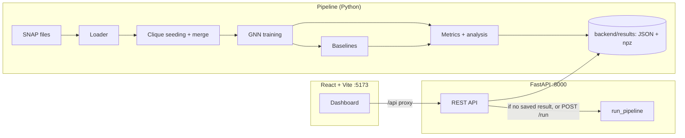

# CircleSense: Overlapping Friend-Circle Detection with Clique Percolation and Graph Neural Networks

BDSMA micro-project, Semester 7. Based on *Paper 4: Overlapping Community Detection: Combining Clique Percolation with Graph Neural Networks* (Module 4: Social Network Structure, Measures and Visualization).

A beginner-friendly walkthrough is in [PROJECT_EXPLANATION.md](PROJECT_EXPLANATION.md). This README is the technical reference and run guide.

---

## 1. The problem

On a social network, one person belongs to several groups at once. A friend can be a college classmate and also a colleague. Louvain and Leiden put every node in exactly one community, so they cannot represent this.

Two families of methods do handle overlap, and each has a weakness:

| Method family | Strength | Weakness |
|---|---|---|
| Clique Percolation (CPM) | Communities are easy to explain: each is a chain of tightly knit cliques | Clique enumeration is slow on dense graphs; nodes outside any clique get no community |
| Graph Neural Networks (NOCD-style) | Scale well, use node attributes, assign every node | Black box: you cannot say why a node is in a community |

**CircleSense combines them.** Clique seeds give interpretable starting communities. A GNN generalises them to the whole graph and outputs soft memberships, so a node can belong to several circles.

## 2. The application

**Automatic friend circles and friend suggestions for a Facebook user.** For one user's friend network the system:

1. Detects the user's circles (family, school, work, ...) without manual labelling.
2. Identifies **bridge friends** who belong to several circles.
3. Suggests new friends from shared circles, and shows which circles justify each suggestion.
4. Explains each circle by the clique seeds it grew from.

## 3. Dataset

**SNAP `ego-Facebook`** (https://snap.stanford.edu/data/ego-Facebook.html): 10 ego-networks, 4,039 friends and 88,234 friendships in total. Ego IDs: 0, 107, 348, 414, 686, 698, 1684, 1912, 3437, 3980.

Per ego: `.edges` (friendships), `.circles` (hand-labelled overlapping circles = ground truth), `.feat` (anonymised binary profile features), `.egofeat`, `.featnames`.

The data is gitignored (`data/raw/`); see [How to run](#8-how-to-run).

## 4. Method (as implemented)

```
ego-network -> clique seeding -> merge -> seed matrix S -> GNN on [X | S] -> membership F -> threshold -> circles
  (A, X)       CPM / weak-clique  Jaccard    (N x K)        SAGE or GAT       (N x K, >= 0)   tau = 0.5     + bridges
                                                                                                          + suggestions
```

1. **Load** the adjacency matrix `A`, features `X` and ground-truth circles ([loader.py](backend/app/data/loader.py)).
2. **Seed** with either k-clique percolation (default k = 4) or weak cliques: a linked pair plus its common neighbours, with start nodes chosen by density priority and partners by Salton index.
3. **Merge** seeds whose Jaccard overlap exceeds 0.6 and keep the top K (K = number of ground-truth circles, capped by the seed count and `max_seeds` = 20, minimum 3).
4. **Build** the seed matrix `S` (N x K, binary). Node input to the GNN is `[X | S]`.
5. **Encode** with a 2-layer GraphSAGE (default) or GAT, hidden size 64, dropout 0.1, non-negative output `F`.
6. **Train** with `L = L_structure + lambda * L_seed` (Adam, lr 0.01, 150 epochs by default, lambda = 1.0).
7. **Assign:** node `u` joins circle `c` if `F[u, c] >= tau`. Unassigned nodes take the most common circle among their neighbours.

### Losses ([losses.py](backend/app/model/losses.py))

- **Bernoulli-Poisson (default):** edge probability `1 - exp(-F_u . F_v)`. Positive loss on edges, plus the mean affinity of sampled non-edges (3x as many negatives as edges).
- **Soft modularity (option):** `-Tr(S^T B S) / 2m` with `S = softmax(F)`. Chosen with `structure_loss = "modularity"`.
- **Seed consistency:** binary cross-entropy between `F` and the seed matrix `S`, tying circle `c` to seed `c`.

### Outputs

| Output | How |
|---|---|
| Circles | Thresholded columns of `F` |
| Bridge friends | Nodes in two or more circles, ranked ([bridges.py](backend/app/analysis/bridges.py)) |
| Friend suggestions | Non-friends ranked by `F_u . F_v`, with the shared circles that contribute ([recommend.py](backend/app/analysis/recommend.py)) |
| Circle explanation | Seed cliques, size, density, conductance, top profile features ([explain.py](backend/app/analysis/explain.py)) |

## 5. System architecture



Storage is plain files: one `ego_<id>.json` (metrics, circles, bridges, explanations, Cytoscape graph) and one `ego_<id>_membership.npz` (the matrix `F`) per network. No database.

## 6. Backend

**Stack:** Python 3.12, FastAPI, Uvicorn, PyTorch (plain, no PyTorch Geometric), NetworkX, NumPy, SciPy, scikit-learn.

| Module | Contents |
|---|---|
| `data/loader.py` | `list_egos`, `load_ego`, `to_graph_tensors` |
| `seeding/cpm.py` | `k_clique_seeds` |
| `seeding/weak_clique.py` | `salton_similarity`, `node_priority`, `weak_clique_seeds` |
| `seeding/merge.py` | `merge_seeds`, `build_seed_matrix` |
| `model/encoder.py` | `GraphSAGELayer`, `GATLayer`, `MembershipGNN` |
| `model/losses.py` | `bernoulli_poisson_loss`, `soft_modularity_loss`, `seed_consistency_loss` |
| `model/train.py` | `train_model`, `assign_communities` |
| `baselines/run.py` | `run_cpm`, `run_leiden_louvain` (NetworkX Louvain), `run_bigclam` (own implementation), `run_gnn_no_seeds` |
| `evaluation/metrics.py` | `overlapping_nmi`, `average_f1`, `omega_index`, `bridge_node_scores`, `community_quality`, `evaluate_all` |
| `analysis/` | `find_bridge_friends`, `suggest_friends`, `evaluate_suggestions`, `explain_circle` |
| `pipeline.py` | `run_pipeline(ego_id, config)` end to end |
| `main.py` | FastAPI app |
| `scripts/run_all.py` | Batch run over all 10 networks |

### REST API

| Method | Endpoint | Returns |
|---|---|---|
| GET | `/api/health` | Status |
| GET | `/api/egos` | All networks with node, edge, circle and bridge counts |
| GET | `/api/egos/{id}/graph` | Cytoscape elements and summary |
| GET | `/api/egos/{id}/communities?method=` | Circles for `hybrid`, `cpm`, `leiden`, `bigclam` or `ground_truth` |
| GET | `/api/egos/{id}/nodes/{node}` | One friend's circles and membership vector |
| GET | `/api/egos/{id}/bridges?top=` | Ranked bridge friends |
| GET | `/api/egos/{id}/recommend/{node}?top=` | Friend suggestions with shared-circle breakdown |
| GET | `/api/egos/{id}/circles/{circle}/explain` | Seeds and quality for a circle |
| GET | `/api/egos/{id}/metrics` | Metrics for all methods and suggestion hit-rates |
| POST | `/api/egos/{id}/run` | Re-run with new settings (`k`, `seeding`, `encoder_type`, `hidden_dim`, `lr`, `epochs`, `structure_loss`, `lambda_seed`, `tau`) |

Interactive docs at `http://127.0.0.1:8000/docs`.

## 7. Frontend

**Stack:** React 19, Vite, Cytoscape.js (graph), Recharts (charts), Axios, lucide-react icons.

| Tab | Shows |
|---|---|
| **Overview** | Intro and one card per ego-network |
| **Graph Explorer** | Interactive network coloured by circle; switch between Hybrid, CPM, Leiden, BigCLAM and GroundTruth; friend search; layout choice; node detail panel |
| **Circles** | Detected circles with size, density, conductance and seed-clique explanation |
| **Bridge Friends** | Ranked friends who belong to several circles |
| **Suggestions** | Pick a friend and see ranked suggestions with the shared circles behind each |
| **Benchmark** | Metric comparison across methods |
| **Settings** | Change run settings and re-run the pipeline |

The Vite dev server proxies `/api` to `http://127.0.0.1:8000` (`frontend/vite.config.js`), so the backend must be running.

## 8. How to run

Run from the project root. Tested on Windows with Python 3.12 and Node 22.

**One-time setup**

Download and unpack the dataset (create `data/raw/` first if it does not exist):

```bash
curl -L -o data/raw/facebook.tar.gz https://snap.stanford.edu/data/facebook.tar.gz
```
```bash
tar -xzf data/raw/facebook.tar.gz -C data/raw
```

Install the dependencies:

```bash
python -m pip install -r backend/requirements.txt
```
```bash
npm --prefix frontend install
```

**Generate results** (about 30 seconds for all 10 networks; optional, since the API computes a network on first request otherwise):

```bash
python backend/scripts/run_all.py
```

**Start the app** in two terminals:

```bash
python -m uvicorn app.main:app --app-dir backend --reload --port 8000
```
```bash
npm --prefix frontend run dev
```

Open http://localhost:5173 for the dashboard.

## 9. Results (our run, 10 ego-networks, 100 epochs via `run_all.py`)

Mean over all 10 networks, against the hand-labelled circles:

| Method | ONMI | Avg F1 | Omega | Runtime (s) |
|---|---|---|---|---|
| **Hybrid (CPM seeds + GNN)** | 0.258 | 0.379 | 0.224 | 0.74 |
| CPM | 0.244 | 0.313 | 0.135 | 0.02 |
| Louvain (disjoint) | **0.339** | **0.384** | **0.322** | 0.05 |
| BigCLAM | 0.088 | 0.366 | 0.036 | 0.53 |
| GNN without seeds | 0.270 | 0.372 | 0.205 | 0.95 |

Friend-suggestion check (hide 10% of edges, hit-rate, mean over 10 networks): hybrid **0.63** vs common-neighbours **0.87**.

How to read this honestly:

- The hybrid beats plain CPM on all three accuracy metrics and ran faster than the GNN without seeds.
- It does **not** beat Louvain on ONMI or Omega in our run, and is level on F1. Louvain is a strong baseline on these small graphs.
- Seeding gives only a small gain over the GNN without seeds in F1 (0.379 vs 0.372), and slightly lower ONMI.
- The hybrid is slower than CPM and Louvain in absolute terms. Any speed advantage over CPM would only appear on much larger graphs, which this dataset does not test.
- For friend suggestions, plain common-neighbours is better than circle affinity on nearly every network (tied on the smallest). Circle-based suggestions are valuable for the explanation they give, not for raw accuracy.
- Results vary between runs (random initialisation and negative sampling) and depend on `epochs`.

`PROJECT_EXPLANATION.md` quotes per-network figures from a different run and some of its claims (for example that suggestions outperform common-neighbours) do not match the numbers above. Re-run `run_all.py` to regenerate yours.

## 10. What we use from which paper

"Access" records how much of each paper we read.

| # | Paper | Access | Used for |
|---|---|---|---|
| Outline | Paper 4 (assigned) | Full | Pipeline: k-clique seeds, GraphSAGE/GAT encoder, soft membership, modularity and seed-consistency loss, baselines, metrics |
| 26 | WOCD: weak cliques (2025) | Full text | Weak-clique seeding (pair plus common neighbours, Salton index) |
| 11 | Dynamic dilated aggregation in deep residual GCN (2022) | Full text | Bernoulli-Poisson link model, Facebook ego-networks as benchmark, threshold on membership |
| 3 | WLNI-LPA (2021) | Full text | Using overlapping communities for social recommendation |
| 16 | Weighted graph community games (2023) | Full text | Bridge-node evaluation (precision, recall, F1), Omega index |
| 20 | Hierarchical clustering on maximal cliques (2024) | Full text | Metric set; unassigned nodes take the neighbours' most common community |
| 30 | ABCD+o2 benchmark (2026) | Full text | Background for synthetic overlap benchmarks (not yet run) |
| 18 | Comparative analysis on social media (2023) | Abstract | Baseline and metric justification |
| 25 | T-OCDIB temporal overlap (2025) | Abstract | Future work only |
| 8 | Review of clique-based OCD (2022) | Title only | Background on CPM |

## 11. Limitations

- **Louvain wins on ONMI and Omega** in our run (see Results); the hybrid's case rests on interpretability and overlap, not top accuracy.
- **Ground truth is partial:** not every friend is in a labelled circle.
- **Features are anonymised,** so circles can be compared by features but not named.
- **Small graphs:** the largest network has about 1,000 nodes, so scalability is not tested. The code uses dense N x N matrices (`to_graph_tensors`, and `GATLayer` is O(N^2)), which would not scale to large graphs as written.
- **Baselines are simplified:** own NumPy BigCLAM, and NetworkX Louvain instead of Leiden.
- **Not implemented from the original plan:** temporal extension, synthetic LFR/ABCD+o2 sensitivity experiments, feature-noise robustness test, PyTorch Geometric and cdlib.
- **Privacy:** a real deployment would infer group membership people did not declare; we use a public anonymised research dataset.

## 12. References

- [3] El Kouni, Karoui, Ben Romdhane. *WLNI-LPA.* ICSOFT 2021.
- [8] Gupta, Singh, Choudhary. *A review of clique-based overlapping community detection algorithms.* KAIS, 2022.
- [11] Muttakin, Hossain, Rahman. *Overlapping Community Detection using Dynamic Dilated Aggregation in Deep Residual GCN.* arXiv:2210.11174.
- [16] Benati et al. *Overlapping communities detection through weighted graph community games.* PLOS ONE, 2023.
- [18] *Comparative Analysis of Overlap Community Detection Techniques on Social Media Platform.* The Computer Journal, 2023.
- [20] Prokop, Dráždilová, Platoš. *Overlapping community detection in weighted networks via hierarchical clustering.* PLOS ONE, 2024.
- [25] Lu, Luo, Zhang. *Beyond Static Boundaries.* ACM TKDD, 2025.
- [26] *WOCD: A Semi-Supervised Method for Overlapping Community Detection Using Weak Cliques.* arXiv:2508.00927.
- [30] *ABCD+o2.* Journal of Complex Networks, 2026.
- Dataset: McAuley, Leskovec. *Learning to Discover Social Circles in Ego Networks.* NIPS 2012.
